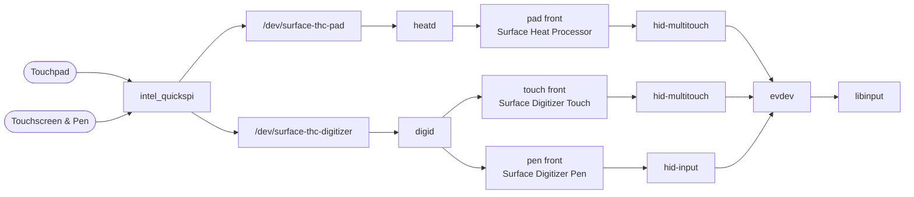

# surface-touch

Touchpad, touchscreen and pen drivers for the Surface Laptop Studio 2 on
Linux. The touchpad is handled by its own daemon, `heatd`, and the
touchscreen and pen by `digid`. The touch hardware sits on two Intel THC SPI ports that the stock
`intel_quickspi` driver doesn't bind, and once bound it sends data nothing
in the kernel decodes.

| Component | Type             | Description                                                        |
| --------- | ---------------- | ------------------------------------------------------------------- |
| `module/` | Kernel driver    | Adds this machine's two THC SPI ports to `intel_quickspi`; built by DKMS. |
| `heatd`   | Userspace daemon | Turns the touchpad's raw data into a standard touchpad.              |
| `digid`   | Userspace daemon | Does the same for the touchscreen and pen.                           |

Each daemon takes its device's raw frames off a hidraw node and replays
them as ordinary HID reports through uhid; hid-multitouch (touchpad and
touchscreen) and hid-input (pen) turn those into standard input devices,
so gestures, scrolling and the rest come from libinput and your desktop.



## Requirements

- **Kernel:** Linux 7.2 or 7.3, with its matching headers.
- **To build:** `dkms`, `make`, GCC 15+, OpenCV 5 — on Arch: `pacman -S dkms opencv`.
- **Secure Boot:** off, unless you sign the module yourself — it ships unsigned.
- **Conflicts:** remove `iptsd` if you have it; this package keeps `ithc` off the ports.

## Install

```
make
sudo make install
```

On Arch you can build a package instead:

```
make dist
cp PKGBUILD surface-touch.install dist/surface-touch-*.tar.gz /some/dir
cd /some/dir && makepkg -si
```

DKMS rebuilds the module on kernel updates. If it didn't, run
`sudo dkms autoinstall`.

To check it works:

```
lspci -nnk -s 00:10.        # both ports: driver in use: intel_quickspi
systemctl status surface-heatd surface-digid
```

The desktop sees three devices: `Surface Heat Processor` (touchpad),
`Surface Digitizer Touch` and `Surface Digitizer Pen`.

To remove: `sudo make uninstall` (or `pacman -R surface-touch`), then reboot.

## When something's wrong

| Symptom                                     | Fix                                                                                     |
| ------------------------------------------- | ---------------------------------------------------------------------------------------- |
| Touch stopped working                       | `systemctl restart surface-heatd surface-digid`                                          |
| Ports not bound to `intel_quickspi`         | Install the matching kernel headers, then `sudo dkms autoinstall`. `Required key not available` in dmesg means Secure Boot. |
| `ithc` bound to the ports instead           | `/etc/modprobe.d/surface-touch.conf` is missing; reinstall and reboot.                   |
| Touchpad frozen, `-110` timeouts in dmesg   | The controller is wedged; reboot.                                                        |

When reporting a problem, include `uname -a`, `lspci -nnk -s 00:10.` and
`journalctl -b -u surface-heatd -u surface-digid`.

## Known issues

- Pen curves can look slightly angular: the hardware only reports the pen
  at 66 Hz.
- The kernel's own touchpad, touchscreen and stylus devices stay listed but
  do nothing while the services run.

## License

`module/` is GPL-2.0-only, everything else MIT. See `NOTICE` and
`LICENSES/`.
